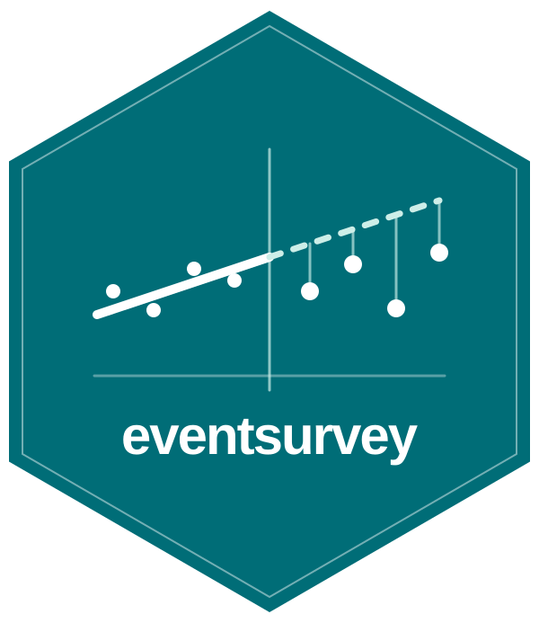

<p align="center" style="padding-top: 2rem;">
  
</p>

<p align="center">
  <a href="https://github.com/yhoriuchi/eventsurvey/actions/workflows/R-CMD-check.yaml"></a>
  
  
</p>

## Causal inference for events during survey fieldwork

`eventsurvey` estimates how survey outcomes change when an event occurs during
fieldwork. It learns the pre-event trend, projects what would have happened
without the event, and compares that counterfactual with the observed
post-event outcomes. The package provides estimates, uncertainty intervals,
automatic diagnostics, figures, and a shareable HTML report.

## Installation

Install the development version from GitHub:

```r
install.packages("remotes")
remotes::install_github("yhoriuchi/eventsurvey")
```

## Quick start

```r
library(eventsurvey)
fit <- eventsurvey(y ~ day, sample_data)
```

In `sample_data`, `y` is a five-category survey response coded from 1 (lowest)
to 5 (highest), and `day` is the interview day relative to the event: negative
values are before the event, 0 is the event day, and positive values are after
the event.
By default, the estimator excludes day 0 because respondents' exposure is
often unclear during the event period; forecasting begins on day 1.

Create a complete, self-contained HTML report with one additional command:

```r
eventsurvey_report(fit)
```

The fitted object checks the data and design automatically, and the HTML report
brings the main estimates, diagnostics, and figures together in one file.

## Choose calibration

The default matches placebo calibration to the estimand: daily effects use
errors at the same elapsed forecast horizon, and the window-average effect
uses signed average errors within each placebo window. Each requires the
corresponding population bias restriction; daily intervals are pointwise.

```r
fit <- eventsurvey(y ~ day, sample_data, calibration = "estimand")
pooled <- eventsurvey(y ~ day, sample_data, calibration = "pooled")
```

`"pooled"` reproduces the calibration used before version 0.3.0. The option
also applies to `eventsurvey_summary()` and covariate-adjusted models.
Inspect `fit$reference_average` and the daily bias bounds in `fit$days`.
See [Methodology](articles/methodology.html) for the assumptions, inference,
and matching requirements for sparse surveys.

## Add pre-event covariates

With respondent-level data, put time first and add baseline characteristics:

```r
adjusted <- eventsurvey(outcome ~ day + age + education, survey_data)
```

Numeric covariates enter linearly; factors and character columns enter as
categorical indicators. Each pre-event window fits its own OLS model. Forecasts
average predictions over each forecast period's respondents, and uncertainty
includes estimated covariate means and overlapping fits. Use characteristics
unaffected by the event, and assess forecasting performance before the event.
See [Covariate Adjustment](articles/covariate-adjustment.html) for a runnable
example, assumptions, and limitations. Summary-only data remain time-only.

## Learn more

- [Getting Started](articles/getting-started.html) — Fit a model and
  create a report.
- [Reading an HTML Report](articles/reading-html-reports.html) — Interpret the
  estimates, diagnostics, and figures.
- [Methodology](articles/methodology.html) — Understand the estimand,
  assumptions, and uncertainty procedure.
- [Examples](articles/published-applications.html) — See the
  workflow applied to published studies.

Browse the [complete article library](articles/index.html) or the
[function reference](reference/index.html).

## Additional Info

### Upcoming features

The current version estimates the effect of one event occurring during one
survey fieldwork period. Future versions may extend the method to repeated
events and to pooling comparable events across fieldwork periods—for example,
designs studying multiple high-level visits. These extensions require new
work on the estimand, dependence across events, and uncertainty.

Other potential features include alternative trend
specifications, survey weights, clustered uncertainty, and richer workflows
for multiple outcomes and subgroups. Each requires additional methodological
development and validation before becoming a public package option.

### Comments, questions, or suggestions?

Please check the [existing GitHub issues](https://github.com/yhoriuchi/eventsurvey/issues).
If your question or suggestion is not already covered, please open a new issue.
