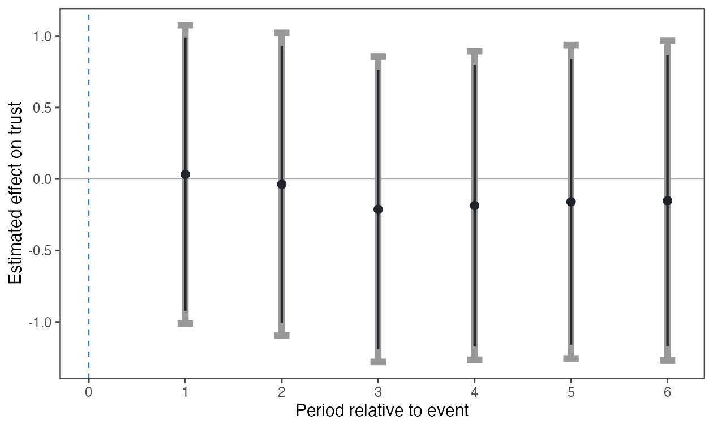

```{r, include = FALSE}
knitr::opts_chunk$set(collapse = TRUE, comment = "#>")
# Website previews use their own reports; installed vignettes use public URLs.
report_base <- if (identical(Sys.getenv("IN_PKGDOWN"), "true")) {
  "../reports/"
} else {
  "https://yhoriuchi.github.io/eventsurvey/reports/"
}
```

These examples apply the same `eventsurvey` workflow to two published studies.
They are package reanalyses, not reproductions of every model in the original
articles. Each report contains estimates, diagnostics, figures, survey
coverage, and analysis settings.

To preserve the established application-specific estimands, these reports
explicitly include the event period in the window-average estimate while
suppressing its day-specific result. This differs from the package's safer
default for new analyses, which excludes the event period when within-period
exposure is unclear.

All main analyses use **estimand-specific calibration**, the default since
version 0.3.0. Each report presents these results first, followed by clearly
labeled **pooled comparisons**. Within each outcome, the data, model, event-day
rule, and target periods are identical; only calibration changes.

The daily bounds use matching elapsed forecast horizons. The average bound
uses the largest absolute signed window-average reference error. These
require target-specific population bias assumptions; the pooled assumption
does not imply them. The daily intervals are pointwise. On sparse schedules,
matching elapsed horizons can also change the set of reference windows.

## Example reports

| Example | Event and outcome | Report |
|:--|:--|:--|
| Bateson and Weintraub (2022) | 2016 U.S. election; trust in the U.S. government | [Main results and pooled comparison](`r report_base`bateson-weintraub.html){target="_blank" rel="noopener noreferrer"} |
| Epifanio, Giani, and Ivandic (2023) | 2005 London bombings; privacy- and procedural-rights restrictions | [Main results and pooled comparison](`r report_base`epifanio-giani-ivandic.html){target="_blank" rel="noopener noreferrer"} |

## Compare average effects

The table shows estimates and 95% honest intervals regenerated with version
0.3.0. It contains analytical results only, not respondent records or input
period summaries. Reference windows are counted separately for each method.

```{r application-comparison, echo = FALSE}
comparison <- read.csv("figures/application-calibration.csv")
comparison$Method <- ifelse(
  comparison$calibration == "estimand",
  "Main: estimand-specific", "Comparison: pooled"
)
comparison$Interval <- sprintf("[%.3f, %.3f]", comparison$conf_low, comparison$conf_high)
knitr::kable(
  comparison[c("outcome", "Method", "effect", "Interval", "n_windows")],
  col.names = c("Outcome", "Method", "Average effect", "95% honest CI", "Reference windows"),
  digits = 3,
  row.names = FALSE
)
```

Point estimates stay the same within each outcome. Differences in intervals
reflect the calibration assumptions and, for sparse schedules, potentially
different reference windows. The reports show each target period and the
corresponding daily results. Both methods' average intervals include zero in
these applications; calibration should be chosen on substantive grounds.

## Bateson and Weintraub (2022)

This report presents a seven-period main analysis and its pooled comparison.
AmericasBarometer data cannot
be redistributed, so the package includes no respondent records or daily
summaries. Authorized users can obtain the data from
[LAPOP/CGD](https://www.vanderbilt.edu/cgd/data-access/) and regenerate the
report locally.

[Open the Bateson--Weintraub report](`r report_base`bateson-weintraub.html){target="_blank" rel="noopener noreferrer"}

### Daily effects: main method and pooled comparison

The two figures hold the data, model, and target dates fixed and share the
same vertical scale. Gray intervals
show 95% confidence limits; dark inner intervals show 90% limits. Daily intervals
are pointwise under the respective calibration assumption.

**Main: estimand-specific calibration**


**Comparison: pooled calibration**



## Epifanio, Giani, and Ivandic (2023)

This report presents separately estimated privacy- and procedural-rights
outcomes with estimand-specific calibration, followed by a pooled comparison
for each outcome. The package includes the period-level sufficient statistics
used in these analyses. Missing survey dates remain unobserved and are not
interpolated.

[Open the Epifanio--Giani--Ivandic report](`r report_base`epifanio-giani-ivandic.html){target="_blank" rel="noopener noreferrer"}

## Reproduce the reports

The rendering scripts regenerate both self-contained HTML reports, the
estimate-only comparison table, and the figures above. Each report contains
both methods with the main analyses first. The Bateson analysis requires an
authorized local source file.

```{r, eval = FALSE}
Sys.setenv(EVENTSURVEY_BATESON_DATA = "/path/to/cleaned_main.csv")
source("data-raw/render-application-reports.R")
source("data-raw/render-bateson-figures-local.R")
```

## References

- Bateson, Regina, and Michael Weintraub. 2022. "The 2016 Election and
  America's Standing Abroad: Quasi-experimental Evidence of a Trump Effect."
  *Journal of Politics* 84(4): 2300--2304.
  [Article](https://doi.org/10.1086/718209) ·
  [Replication materials](https://doi.org/10.7910/DVN/YRJ6E3)

- Epifanio, Mariaelisa, Marco Giani, and Ria Ivandic. 2023. "Wait and See?
  Public Opinion Dynamics after Terrorist Attacks." *Journal of Politics*
  85(3): 843--859.
  [Article](https://doi.org/10.1086/723020) ·
  [Replication materials](https://doi.org/10.7910/DVN/AUHSMD)

## Also see

- [Getting Started](getting-started.html) to fit the package's bundled sample
  data and create a report.
- [Reading an HTML Report](reading-html-reports.html) to interpret the
  estimates, diagnostics, and figures in these examples.
- [Estimating from Period-Level Summary Data](summary-data.html) for analyses
  like the Epifanio--Giani--Ivandic example when respondent records cannot be
  distributed.
- [Complete Example Workflow](example-workflow.html) for an end-to-end
  simulated analysis with sensitivity checks.
