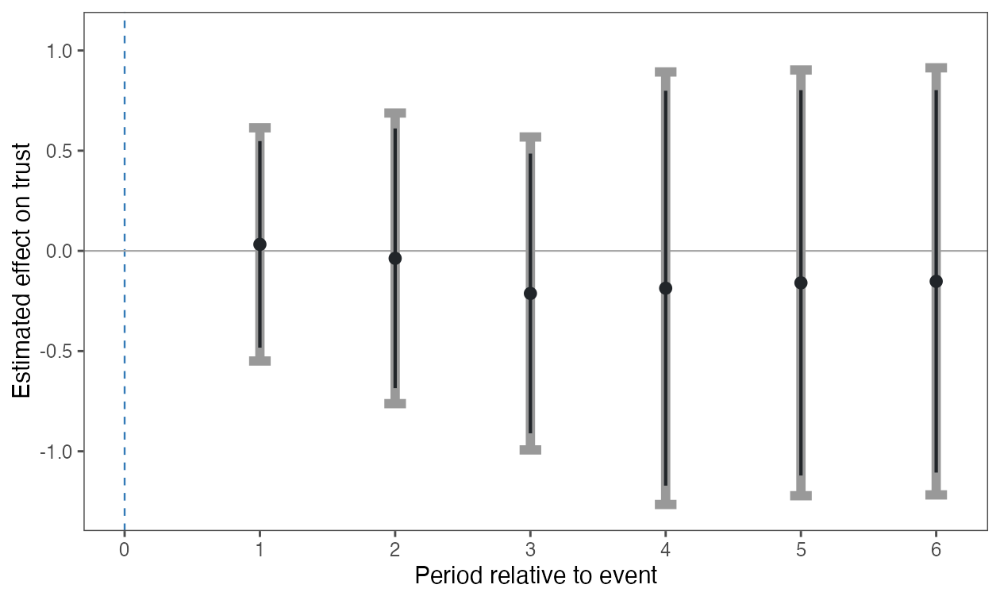

```{r, include = FALSE}
knitr::opts_chunk$set(collapse = TRUE, comment = "#>")
# Website previews use their own reports; installed vignettes use public URLs.
report_base <- if (identical(Sys.getenv("IN_PKGDOWN"), "true")) {
  "../reports/"
} else {
  "https://yhoriuchi.github.io/eventsurvey/reports/"
}
```

These examples apply the same `eventsurvey` workflow to two published studies.
They are package reanalyses, not reproductions of every model in the original
articles. Each report contains estimates, diagnostics, figures, survey
coverage, and analysis settings.

To preserve the established application-specific estimands, these reports
explicitly include the event period in the window-average estimate while
suppressing its day-specific result. This differs from the package's safer
default for new analyses, which excludes the event period when within-period
exposure is unclear.

All analyses use **estimand-specific calibration**. Daily bounds use matching
elapsed forecast horizons. Period-average effects and bias bounds aggregate
daily quantities after calibration. Average honest intervals use
Bonferroni-adjusted daily intervals before aggregation; the displayed daily
intervals are pointwise. The average standard errors include cross-day
covariance. Validity requires the daily population bias restrictions.

## Example reports

| Example | Event and outcome | Report |
|:--|:--|:--|
| Bateson and Weintraub (2022) | 2016 U.S. election; trust in the U.S. government | [Full analysis report](`r report_base`bateson-weintraub.html){target="_blank" rel="noopener noreferrer"} |
| Epifanio, Giani, and Ivandic (2023) | 2005 London bombings; privacy- and procedural-rights restrictions | [Full analysis report](`r report_base`epifanio-giani-ivandic.html){target="_blank" rel="noopener noreferrer"} |

## Compare average effects

The table shows estimates and 95% honest intervals regenerated with version
0.3.0.9000, using the same estimator as release 0.4.0. It contains analytical
results only, not respondent records or input period summaries. Reference
windows are counted separately for each outcome.

```{r application-comparison, echo = FALSE}
comparison <- read.csv("figures/application-calibration.csv")
comparison$Interval <- sprintf("[%.3f, %.3f]", comparison$conf_low, comparison$conf_high)
knitr::kable(
  comparison[c("outcome", "effect", "Interval", "n_windows")],
  col.names = c("Outcome", "Average effect", "95% honest CI", "Reference windows"),
  digits = 3,
  row.names = FALSE
)
```

The reports identify each target period and show its daily results.

## Bateson and Weintraub (2022)

This report presents a seven-period analysis.
AmericasBarometer data cannot
be redistributed, so the package includes no respondent records or daily
summaries. Authorized users can obtain the data from
[LAPOP/CGD](https://www.vanderbilt.edu/cgd/data-access/) and regenerate the
report locally.

[Open the Bateson--Weintraub report](`r report_base`bateson-weintraub.html){target="_blank" rel="noopener noreferrer"}

### Daily effects

Gray intervals show pointwise 95% confidence limits; dark inner intervals
show pointwise 90% limits.



## Epifanio, Giani, and Ivandic (2023)

This report presents separately estimated privacy- and procedural-rights
outcomes with estimand-specific calibration. The package includes the period-level sufficient statistics
used in these analyses. Missing survey dates remain unobserved and are not
interpolated.

[Open the Epifanio--Giani--Ivandic report](`r report_base`epifanio-giani-ivandic.html){target="_blank" rel="noopener noreferrer"}

## Reproduce the reports

The rendering scripts regenerate both self-contained HTML reports, the
estimate-only comparison table, and the figures above. Each report contains
both methods with the main analyses first. The Bateson analysis requires an
authorized local source file.

```{r, eval = FALSE}
Sys.setenv(EVENTSURVEY_BATESON_DATA = "/path/to/cleaned_main.csv")
source("data-raw/render-application-reports.R")
source("data-raw/render-bateson-figures-local.R")
```

## References

- Bateson, Regina, and Michael Weintraub. 2022. "The 2016 Election and
  America's Standing Abroad: Quasi-experimental Evidence of a Trump Effect."
  *Journal of Politics* 84(4): 2300--2304.
  [Article](https://doi.org/10.1086/718209) ·
  [Replication materials](https://doi.org/10.7910/DVN/YRJ6E3)

- Epifanio, Mariaelisa, Marco Giani, and Ria Ivandic. 2023. "Wait and See?
  Public Opinion Dynamics after Terrorist Attacks." *Journal of Politics*
  85(3): 843--859.
  [Article](https://doi.org/10.1086/723020) ·
  [Replication materials](https://doi.org/10.7910/DVN/AUHSMD)

## Also see

- [Getting Started](getting-started.html) to fit the package's bundled sample
  data and create a report.
- [Reading an HTML Report](reading-html-reports.html) to interpret the
  estimates, diagnostics, and figures in these examples.
- [Estimating from Period-Level Summary Data](summary-data.html) for analyses
  like the Epifanio--Giani--Ivandic example when respondent records cannot be
  distributed.
- [Complete Example Workflow](example-workflow.html) for an end-to-end
  simulated analysis with sensitivity checks.
